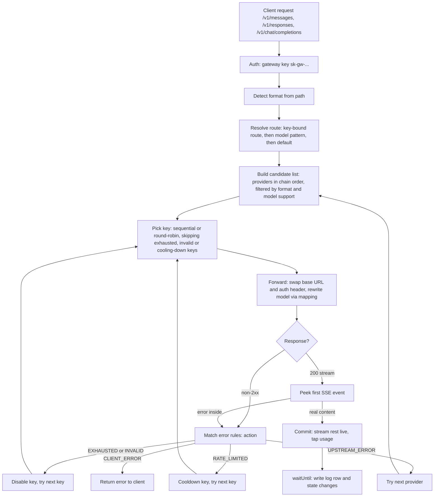

# AI Relay Gateway on Cloudflare Workers (free tier)

A personal API gateway for **Claude Code** and **Codex**. It holds many AI relay providers, each with many API keys. When a key runs out of balance, it moves to the next key. When every key of a provider is used up, it moves to the next provider in a chain you define.

## Decisions from the interview

| # | Topic | Decision |
|---|---|---|
| Q1/Q2 | Client API | **Transparent passthrough.** No format translation. Each provider is tagged with the formats it supports: `anthropic`, `openai-chat`, `openai-responses` |
| Q3 | Models | Per-provider **model mapping** and **allow-list**. The model list is **fetched from `/v1/models`** when a provider is added (button to refresh) |
| Q4 | Routing | **Named routes**, each an ordered provider chain. Picked by gateway key, then model pattern, then `default` |
| Q5 | Key selection | **Sequential** by default. **Round-robin** can be chosen per provider |
| Q6 | Errors | Built-in default rules plus editable per-provider rules (status + body regex → action). Exhausted keys come back through manual re-enable **or** automatic re-check every N hours |
| Q7 | Streaming | **Peek the first SSE event** of a 200 stream before sending anything. After that it is a live pipe (adds under 1 ms) |
| Q8 | Stack | **Cloudflare only**: Workers + Hono (TypeScript) + D1 + Workers Static Assets + Cron Triggers |
| Q9 | Admin | **Web dashboard on the same Worker**: Vite + vanilla TS, premium dark UI |
| Q10 | Security | `sk-gw-…` gateway keys bound to routes. `ADMIN_PASSWORD` secret with a signed cookie. Upstream keys **encrypted with AES-GCM** |
| Q11 | Logs | Metadata + token usage, 7-day retention (configurable), no request/response bodies |
| Q12 | Balance | Standard billing endpoint, or a custom endpoint (path + JSON field), or `N/A`. Re-check order: balance, then optional 1-token test request, then manual |
| Q13 | Deploy | `npm run setup` (Wrangler) **and** a "Deploy to Cloudflare" button / GitHub auto-deploy |

### URLs (one Worker, one domain)

The dashboard and the API share one domain, separated by path:

| Path | Purpose |
|---|---|
| `https://ai-gateway.<you>.workers.dev/` | Dashboard |
| `/v1/*` | Proxy API for Claude Code and Codex |
| `/api/admin/*` | Dashboard backend (cookie auth) |

**Claude Code** (`~/.bashrc` or `settings.json`):

```bash
export ANTHROPIC_BASE_URL="https://ai-gateway.<you>.workers.dev"
export ANTHROPIC_AUTH_TOKEN="sk-gw-xxxxxxxx"
```

**Codex** (`~/.codex/config.toml`):

```toml
model_provider = "gateway"
[model_providers.gateway]
name = "AI Gateway"
base_url = "https://ai-gateway.<you>.workers.dev/v1"
env_key = "GATEWAY_KEY"
wire_api = "responses"
```

---

## Free-tier budget (confirmed, $0)

| Resource | Free limit | Our usage |
|---|---|---|
| Workers requests | 100k/day | 1 per client request |
| Workers CPU | 10 ms per request | Waiting on the upstream doesn't count. Peek and usage scan use cheap `indexOf`-style scanning |
| Subrequests | 50 per request | Max failover attempts capped at **10** (configurable) |
| D1 writes | 100k rows/day | 1 log row per request, plus key-state writes **only when a state changes** |
| D1 reads | 5M rows/day | Config cached in Worker memory for 30 s, invalidated by a version counter when the admin edits anything |
| Cron Triggers | Free | Every 15 min (re-checks), daily (log cleanup) |

> [!WARNING]
> **Risk: 10 ms CPU.** Very long streams with many chunks spend a little CPU on usage scanning. Scanning is cheap (`indexOf("usage")`, and full JSON parsing only for matching events). There is a per-provider toggle to **turn off usage parsing** if CPU limits are ever hit.

---

## Request flow



**Header handling:**
- **Anthropic format** sends `x-api-key: <key>` plus `Authorization: Bearer <key>`, since relays accept either.
- **OpenAI formats** send `Authorization: Bearer <key>`.
- `anthropic-version`, `anthropic-beta` and `openai-*` headers pass through unchanged.
- Client auth headers and `cf-*` headers are stripped.

**`GET /v1/models`** returns the merged model list of the providers on the caller's route, so Codex and Claude Code model pickers work.

### Default error rules (editable, global; per-provider rules are checked first)

| Match | Action |
|---|---|
| `402` (any body) | EXHAUSTED |
| Any status + body matches `insufficient_quota\|insufficient balance\|余额不足\|quota.*(exceeded\|exhausted)\|credit balance is too low\|billing\|额度` | EXHAUSTED |
| `401`, or body `invalid.*(api.?key\|token)\|无效的令牌\|token.*(expired\|disabled)` | INVALID_KEY |
| `429` without quota text | RATE_LIMITED (cooldown = `Retry-After`, or 60 s) |
| `5xx`, timeout, network error, `529` overloaded | UPSTREAM_ERROR (next provider, no penalty) |
| `400`, `404`, `413`, `422` without the above | CLIENT_ERROR (return to client) |

---

## Proposed Changes

### Project scaffold

#### [NEW] package.json
Hono, Wrangler, Vite, TypeScript, Vitest and `@cloudflare/vitest-pool-workers`. Scripts: `dev`, `build`, `deploy`, `setup`, `test`, `db:migrate`.

#### [NEW] wrangler.jsonc
- Worker entry
- D1 binding `DB`
- Static assets binding pointing to the dashboard build output, served at `/`
- Cron triggers `*/15 * * * *` and `0 3 * * *`

#### [NEW] tsconfig.json, vite.config.ts, .gitignore, .dev.vars.example

---

### Database

#### [NEW] migrations/0001_init.sql

| Table | Key columns |
|---|---|
| `providers` | `name`, `base_url`, `formats` (JSON), `key_strategy`, `model_map` (JSON), `models` (JSON, fetched), `model_allowlist_enabled`, `balance_mode` (`standard`\|`custom`\|`none`), `balance_path`, `balance_field`, `recheck_mode` (`balance`\|`test`\|`manual`), `recheck_hours`, `parse_usage`, `timeout_ms`, `enabled` |
| `provider_keys` | `provider_id`, `alias`, `key_enc` (AES-GCM), `priority`, `status` (`active`\|`exhausted`\|`rate_limited`\|`invalid`\|`disabled`), `cooldown_until`, `status_reason`, `balance`, `balance_checked_at`, `rr_cursor` helper, `last_used_at`, `success_count`, `fail_count` |
| `routes` | `name`, `model_patterns` (JSON globs such as `claude-*`), `is_default` |
| `route_providers` | `route_id`, `provider_id`, `position` |
| `error_rules` | `provider_id` (NULL = global), `priority`, `status_codes`, `body_regex`, `action`, `cooldown_s`, `enabled` |
| `gateway_keys` | `name`, `key_hash` (SHA-256), `key_prefix`, `route_id` (NULL = match by model pattern), `enabled`, `last_used_at` |
| `request_logs` | `ts`, `gateway_key_id`, `route_id`, `format`, `model`, `provider_id`, `key_id`, `status`, `latency_ms`, `ttfb_ms`, `input_tokens`, `output_tokens`, `attempts` (JSON trail), `error` |
| `settings` | `log_retention_days`, `max_attempts`, `config_version` |

Seeds the default error rules and a `default` route.

---

### Worker backend (`src/worker/`)

#### [NEW] index.ts
Hono app that mounts `/v1/*`, `/api/admin/*` and the static assets fallback. Also exports the `scheduled()` handler.

#### [NEW] proxy/
- `formats.ts`: maps request paths to formats and builds auth headers per format.
- `forward.ts`: the failover loop. Runs candidate iteration, attempt trail, timeouts and the max-attempts cap.
- `stream-peek.ts`: reads up to the first complete SSE event (max 4 KB), then re-emits the buffered bytes and pipes the rest.
- `usage.ts`: a lightweight `TransformStream` that extracts tokens from three places:
  - Anthropic `message_start` / `message_delta` events
  - OpenAI chat final usage chunk
  - Responses API `response.completed` event

#### [NEW] routing/
- `resolve-route.ts`: picks the route from the gateway key, then glob matching on the model name, then the default route.
- `select-key.ts`: sequential or round-robin selection that respects status and cooldowns.
- `error-rules.ts`: classifier (status + regex → action). Per-provider rules are checked before global ones.
- `model-map.ts`: model mapping and allow-list filtering.

#### [NEW] db/
- `repo.ts`: typed D1 queries.
- `cache.ts`: in-memory config cache with version check.
- `crypto.ts`: AES-GCM encrypt/decrypt using the `ENCRYPTION_KEY` secret, and SHA-256 hashing for gateway keys.

#### [NEW] admin/
- `auth.ts`: password login and HMAC-signed cookie, plus a rate limit on login attempts.
- CRUD endpoints for providers, keys (bulk paste: one key per line), routes (reorder chain), error rules, gateway keys (key shown once on creation) and settings.
- `POST /providers/:id/fetch-models`
- `POST /keys/:id/check-balance`
- `POST /keys/:id/test`
- `POST /keys/:id/enable`
- `GET /logs`, filterable and paginated.
- `GET /stats`: per provider/key counts, tokens, error breakdown, last 24 h / 7 d.

#### [NEW] balance.ts
Three modes:
- **Standard**: `/v1/dashboard/billing/subscription` minus `/usage`.
- **Custom**: user-defined path plus a JSON field path such as `data.quota`.
- **None**: shows `N/A`.

#### [NEW] cron.ts
- **Every 15 min**: re-check keys that are due (balance check, then optional 1-token test request; otherwise they stay off) and clear expired cooldowns.
- **Every few hours**: refresh balances.
- **Daily**: delete logs past the retention period.

---

### Dashboard (`src/dashboard/`, Vite + vanilla TS)

#### [NEW] index.html, main.ts, router.ts, api.ts

#### [NEW] styles/index.css
Design tokens for a premium dark UI:
- HSL palette with a violet/cyan accent
- Inter font
- Glass cards and smooth micro-animations

#### [NEW] views/
| View | Contents |
|---|---|
| **Overview** | Requests, tokens, failover count, health of every key (colored pills) |
| **Providers** | Add/edit, format tags, "Fetch models", model mapping table, balance and re-check config, per-provider error rules |
| **Keys** | Per-provider list: status, balance, last used, enable/disable/test, drag to reorder priority |
| **Routes** | Model patterns, drag-and-drop provider chain |
| **Gateway Keys** | Create (shown once), bind to route, revoke. Includes ready-to-copy Claude Code / Codex config snippets |
| **Logs** | Live table with an expandable failover trail per request |
| **Settings** | Retention, max attempts, global error rules |

---

### Deployment and docs

#### [NEW] scripts/setup.mjs
One command (`npm run setup`) that:
1. Checks the `wrangler login` state
2. Creates the D1 database and writes its ID into `wrangler.jsonc`
3. Applies migrations
4. Prompts for `ADMIN_PASSWORD` and generates `ENCRYPTION_KEY` and `SESSION_SECRET` as secrets
5. Builds the dashboard
6. Deploys and prints the URL

#### [NEW] .github/workflows/deploy.yml
Auto-deploy on push, using the `CLOUDFLARE_API_TOKEN` and `CLOUDFLARE_ACCOUNT_ID` repo secrets.

#### [NEW] README.md
- "Deploy to Cloudflare" button (auto-provisions D1 and prompts for secrets)
- CLI setup steps
- Claude Code and Codex config
- How error rules work

---

## Verification Plan

### Automated tests (Vitest + `@cloudflare/vitest-pool-workers`, real local D1)
- **Error classifier**: each default rule, plus per-provider rules taking precedence over global ones.
- **Key selection**: sequential vs round-robin; skipping exhausted, invalid and cooling-down keys.
- **Route resolution**: gateway-key binding, then model glob, then default.
- **Failover integration** with mocked upstreams:
  - Key 1 returns 402, so the request moves to key 2 (200)
  - All keys of A exhausted, so it moves to provider B
  - 200 stream whose first event is an error triggers failover
  - 400 is returned to the client with no retry
  - Format filtering skips providers without `anthropic` support
- **Stream peek**: bytes match exactly after re-emit, and chunk boundaries split mid-event.
- **Usage parsing** for all three formats.
- **Crypto**: encrypt/decrypt round-trip.
- **Admin auth**: rejects requests without a valid cookie.

### Manual verification
- `npm run dev` (local Workers runtime + local D1): browse the dashboard, add a provider, fetch models, create a gateway key.
- Point Claude Code and Codex at `localhost`, run a short session, and check the logs and token counts.
- Add a deliberately empty-balance key first in the chain and confirm a seamless failover appears in the log trail.
- `npm run setup` against your Cloudflare account, then repeat the checks on the `*.workers.dev` URL.
